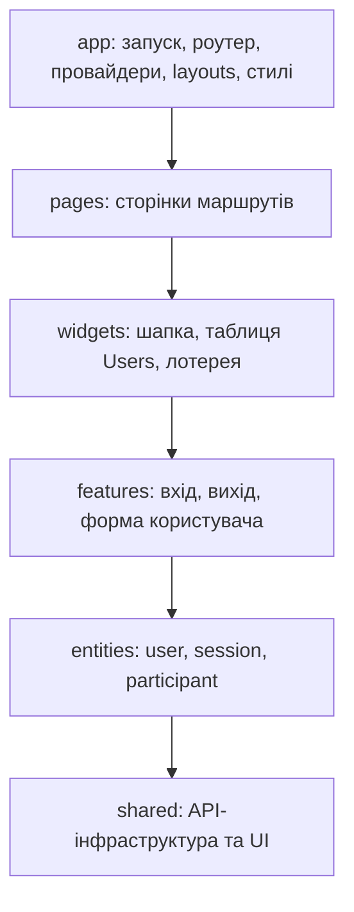

# Vue Lottery

Навчальний Vue-застосунок із лотереєю на головній сторінці та окремим розділом користувачів DummyJSON. Розділ Users підтримує пошук, пагінацію, перегляд профілю, створення, редагування й видалення користувачів. Авторизація працює через JWT; захищені маршрути доступні після входу.

## Локальний запуск

Потрібен Node.js 24.15 або новіший.

```sh
npm ci
cp .env.example .env
npm run dev
```

Адреса API задається в `.env` змінною `VITE_API_URL`. Файл `.env` не зберігається в Git.

## Перевірки

```sh
npm run lint
npm test
npm run build
```

## GitHub Pages

Workflow [deploy.yml](.github/workflows/deploy.yml) запускається після push у `feature/routing` і публікує каталог `dist`. Для першого деплою у налаштуваннях репозиторію **Settings → Pages → Build and deployment → Source** слід вибрати **GitHub Actions**. Адреса сайту: <https://swagdispenser.github.io/vue-lottery-app/>.

У production-збірці Vite використовує базовий шлях `/vue-lottery-app/`. Файл `404.html` перенаправляє прямі посилання на маршрути, наприклад `/users/1`, до застосунку й відновлює початковий URL перед запуском Vue Router.

DummyJSON імітує POST, PUT і DELETE: після відповіді API зміни показуються у локальному стані застосунку та не зберігаються на сервері.

## Структура Feature-Sliced Design



Модуль може залежати від будь-якого нижчого шару. Слайси одного шару незалежні; зовнішні імпорти використовують їхні публічні `index.ts`. Усередині слайса дозволені відносні імпорти між його файлами.

Точка входу — `src/app/main.ts`. Кожна сторінка має власний слайс у `pages`; деталі й вкладена форма редагування належать до одного слайса `user-details`. Початкова лотерея збережена як самодостатній `widgets/lottery`.

## Repository та реєстрація сервісів

| Розташування | Відповідальність |
| --- | --- |
| `shared/api` | HTTP-клієнт, generic-інтерфейси Repository, універсальний `ServiceProvider` |
| `shared/config` | Адреса API зі змінної `VITE_API_URL` |
| `entities/user/api` | `UserService`: запити читання, створення, оновлення та видалення користувачів |
| `entities/session/api` | `AuthService`: вхід, перевірка сесії та оновлення токенів |
| `app/providers/services.ts` | Налаштування HTTP-клієнта та реєстрація конкретних сервісів |

`app/main.ts` викликає `registerServices()` перед відновленням сесії та підключенням роутера. Сервіси отримують налаштований HTTP-клієнт через конструктор. Реєстр створює сервіс лише при першому `ServiceProvider.get<T>()` і повертає той самий екземпляр наступним споживачам. Повторна реєстрація фабрики скидає її попередній екземпляр. Шар `shared` не імпортує сутності з `entities`.
