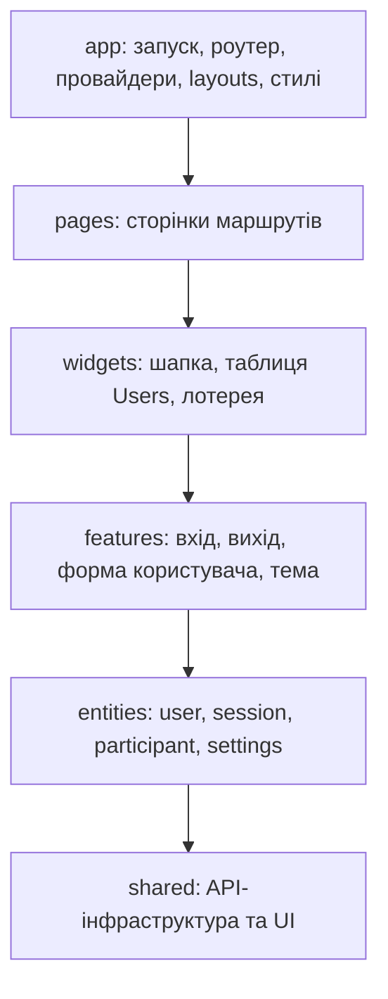

# Vue Lottery

Навчальний Vue-застосунок із лотереєю на головній сторінці та окремим розділом користувачів DummyJSON. Розділ Users підтримує пошук, пагінацію, перегляд профілю, створення, редагування й видалення користувачів. Авторизація працює через JWT; захищені маршрути доступні після входу.

## Локальний запуск

Потрібен Node.js 24.15 або новіший.

```sh
npm ci
cp .env.example .env
npm run dev
```

Адреса API задається в `.env` змінною `VITE_API_URL`. Файл `.env` не зберігається в Git.

## Перевірки

```sh
npm run lint
npm run lint:fsd
npm test
npm run build
```

## GitHub Pages

Workflow [deploy.yml](.github/workflows/deploy.yml) запускається після push у `feature/routing` і публікує каталог `dist`. Для першого деплою у налаштуваннях репозиторію **Settings → Pages → Build and deployment → Source** слід вибрати **GitHub Actions**. Адреса сайту: <https://swagdispenser.github.io/vue-lottery-app/>.

У production-збірці Vite використовує базовий шлях `/vue-lottery-app/`. Файл `404.html` перенаправляє прямі посилання на маршрути, наприклад `/users/1`, до застосунку й відновлює початковий URL перед запуском Vue Router.

DummyJSON імітує POST, PUT і DELETE: після відповіді API зміни показуються у локальному стані застосунку та не зберігаються на сервері.

## Структура Feature-Sliced Design



Модуль може залежати від будь-якого нижчого шару. Слайси одного шару незалежні; зовнішні імпорти використовують їхні публічні `index.ts`. Усередині слайса дозволені відносні імпорти між його файлами.

Точка входу — `src/app/main.ts`. Кожна сторінка має власний слайс у `pages`; деталі й вкладена форма редагування належать до одного слайса `user-details`. Початкова лотерея збережена як самодостатній `widgets/lottery`.

## Repository та реєстрація сервісів

| Розташування | Відповідальність |
| --- | --- |
| `shared/api` | HTTP-клієнт, generic-інтерфейси Repository, універсальний `ServiceProvider` |
| `shared/config` | Адреса API зі змінної `VITE_API_URL` |
| `entities/user/api` | `UserService`: запити читання, створення, оновлення та видалення користувачів |
| `entities/session/api` | `AuthService`: вхід, перевірка сесії та оновлення токенів |
| `app/providers/services.ts` | Налаштування HTTP-клієнта та реєстрація конкретних сервісів |

`app/main.ts` викликає `registerServices()` перед відновленням сесії та підключенням роутера. Сервіси отримують налаштований HTTP-клієнт через конструктор. Реєстр створює сервіс лише при першому `ServiceProvider.get<T>()` і повертає той самий екземпляр наступним споживачам. Повторна реєстрація фабрики скидає її попередній екземпляр. Шар `shared` не імпортує сутності з `entities`.

## Керування станом у Pinia

- `entities/session/model/session.store.ts`: setup store `useSessionStore`. `setSession` встановлює токени й профіль, `clearSession` очищає їх, `restoreSession` відновлює перевірені дані з localStorage. `ensureAuthenticated` перевіряє `/auth/me`, а HTTP-клієнт викликає `refreshAccessToken` при 401. Незавершений запит не може відновити сесію після виходу.
- `entities/user/model/users.store.ts`: setup store `useUsersStore` з `users`, `total`, `isLoading`, `error` та діями `fetchUsers`, `fetchUser`, `createUser`, `updateUser`, `removeUser`. Профіль, помилки й зайнятість форми також зберігаються у store. Сторінки отримують реактивні дані через `storeToRefs` і не викликають сервіси напряму.
- Оскільки DummyJSON не записує зміни на сервері, store зберігає створені, оновлені й видалені записи та накладає їх на відповіді API. Створені записи мають унікальні від’ємні ID. Редагування чи видалення такого запису відбувається локально: сервер його не знає. Зміни скидаються після Logout або перезавантаження застосунку.
- Пошук і номер сторінки залишаються у query-параметрах URL. Store відповідає за дані, а сторінка — за синхронізацію маршруту.
- `app/providers/session.ts` налаштовує HTTP-авторизацію та очищає Users при зміні користувача сесії. Сутності `session` та `user` не імпортують одна одну.

Ручне збереження сесії (`watch`, `JSON.stringify`, перевірка JSON при відновленні, обробка помилок сховища) залишено в `session.store.ts`. `pinia-plugin-persistedstate` підключено для налаштувань теми; одночасно два механізми для сесії не застосовуються.

## UI-обгортки PrimeVue

PrimeVue 4 налаштовано у `app/providers/ui.ts`: preset Aura, власна бірюзова палітра, ToastService, українські підписи закриття. Темна палітра компонентів прив’язана до класу `.app-dark`, який перемикається разом зі станом settings store. Стилі бібліотеки додаються для використаних компонентів, глобальної реєстрації всіх компонентів немає.

Публічний API — `shared/ui/index.ts`:

| Обгортка | Компонент PrimeVue та призначення |
| --- | --- |
| `AppButton` | Button; варіанти primary/secondary/danger/ghost, loading, disabled, slot/label |
| `AppInput` | InputText; `v-model`, label, типи полів (зокрема date/password/number), текст помилки, `aria-invalid` і зв’язок з помилкою через `aria-describedby`; передає blur/change для VeeValidate |
| `AppTable<TRow>` | DataTable + Column; типізовані rows/columns, унікальний rowKey, слоти `cell-<key>`, loading та порожній стан |
| `AppConfirmDialog` | Dialog; підтвердження/скасування, Esc і клік по фону, блокування закриття під час запиту, помилка операції |
| `AppNotifications`, `useNotification` | Toast; одна область сповіщень у App.vue та методи `success`/`error` без залежності споживачів від API бібліотеки |

Компоненти й composable PrimeVue імпортуються тільки у `shared/ui` та `app/providers/ui.ts`. Бізнес-типи не потрапляють у UI-обгортки. Форми входу й користувача інтегровані з AppInput через VeeValidate; таблиці Users та лотереї, підтвердження видалення й модальні форми використовують UI-обгортки.

## Використання обгорток у застосунку

- `features/auth/ui/LoginForm.vue`: AppInput + VeeValidate/Yup, інлайн-помилка авторизації та error toast; AppButton відображає loading. Logout використовує AppButton та очищення session store.
- `features/user-form/ui/UserForm.vue`: спільна форма створення/редагування; AppInput для тексту, email, пароля, віку й телефону; унікальні id та зв’язки label/error. Обов’язковість, email, мінімальна довжина пароля й допустимий вік перевіряються Yup. Стать обирається нативним select з тією ж схемою валідації.
- `widgets/users-table`: AppTable з типом рядка User, посиланнями деталей/редагування й AppButton для видалення. `pages/users` працює через useUsersStore, показує AppConfirmDialog, success/error toast та зберігає пошук/пагінацію у URL.
- `pages/user-details/ui/UserEditView.vue`: оновлення через store, сповіщення про результат і повернення на профіль.
- `widgets/lottery`: AppTable зі слотами заголовків для сортування, AppInput у SearchBar із debounce 300 мс, AppConfirmDialog при видаленні. Пошук, порядок сортування, localStorage учасників та правила вибору переможців збережено.
- `shared/ui/app-modal`: PrimeVue Dialog керує фокусом, Esc, фоном і блокуванням скролу. Під час збереження форму не можна випадково закрити. Обидві таблиці мають горизонтальний скрол на вузьких екранах.

Повідомлення результатів надсилаються через useNotification. Компоненти сторінок/віджетів не імпортують PrimeVue та не викликають сервіси; дані Users і сесія керуються Pinia stores. Імпорти Bootstrap скорочено до базових стилів root/reboot та їхніх SCSS-залежностей.

## Світла й темна тема та persistedstate

- `entities/settings/model/settings.store.ts`: setup store `useSettingsStore`, тип Theme (`light` / `dark`), getter `isDark`, дії `setTheme` і `toggleTheme`. За замовчуванням тема світла.
- `features/theme/ui/ThemeToggle.vue`: перемикач через AppButton та storeToRefs. Є у шапці й AuthLayout (сторінка Login); має зрозумілий текст дії та `aria-pressed`.
- `app/providers/pinia`: реєстрація pinia-plugin-persistedstate. Опція `persist` у settings store зберігає тільки `theme` (`pick`) у ключі `vue-lottery-settings`. Плагін сам відновлює значення при створенні store і зберігає наступні зміни. Serializer перевіряє значення; некоректний JSON перехоплює плагін, і залишається початкова світла тема.
- `app/providers/theme.ts`: перед mount підписується на тему, синхронно перемикає `.app-dark` для PrimeVue та `data-bs-theme` для базових Bootstrap-стилів.
- `app/styles/main.scss`: CSS-змінні для фону, поверхонь, тексту, меж, акцентів і помилок. Ними користуються сторінки, шапка, лотерея та повідомлення форм. Нативні поля дати враховують `color-scheme`.

### Порівняння двох способів збереження

| Ознака | Ручний session.store.ts | settings.store.ts + persistedstate |
| --- | --- | --- |
| Збереження | Власний watch, JSON.stringify, setItem/removeItem | Плагін підписується на зміни стану |
| Відновлення | Явний restoreSession, перевірка токенів і профілю | Автоматичне при створенні store; serializer перевіряє theme |
| Вибір полів | Об’єкт із токенами та безпечними полями профілю | Декларативне pick: ['theme'] |
| Помилки сховища | Власні try/catch та storageError у формі | Плагін перехоплює помилки; налаштування далі діє у пам’яті |
| Очищення | clearSession видаляє ключ авторизації | Тема не скидається при Logout |

Плагін підключений один раз, але зберігає лише stores із `persist`. Users не зберігається ним у localStorage. Сесія продовжує працювати через ручну реалізацію; налаштування теми не містить токенів або профілю.

## Перевірка архітектури FSD

`eslint.fsd.config.js` налаштовує eslint-plugin-boundaries 7 через актуальне правило `boundaries/dependencies`. `eslint.config.mjs` підключає ту саму конфігурацію, тому FSD-помилки видно і під час звичайного `npm run lint`, і в редакторі. `npm run lint:fsd` окремо перевіряє архітектуру без попереджень.

| Звідки | Дозволені зовнішні залежності проєкту |
| --- | --- |
| app | pages, widgets, features, entities, shared |
| pages | widgets, features, entities, shared |
| widgets | features, entities, shared |
| features | entities, shared |
| entities | shared |
| shared | інші сегменти shared |

- Кожен слайс pages/widgets/features/entities класифіковано як окремий елемент. Усередині нього можна імпортувати власні файли; імпорт іншого слайса того ж шару заборонений.
- app — єдиний елемент без слайсів. Сегменти shared мають власні Public API: для міжсегментних залежностей потрібен index.ts.
- Усі дозволені залежності між елементами проходять тільки через index.ts. Заборона глибоких імпортів стосується alias @, відносних шляхів, import type, export from та динамічного import().
- Невідомі локальні залежності та файли поза визначеною структурою — помилки. TypeScript resolver використовує tsconfig.app.json і розпізнає @ → src, .ts та .vue. Нерозпізнаний @/... не отримує дозволу npm-пакета.
- Прямі імпорти primevue, @primevue та @primeuix дозволені лише у shared/ui та app/providers/ui.ts.
- `tests/fsdLint.test.ts` перевіряє дозволені/заборонені приклади через реальний ESLint і наявність index.ts у кожного слайса/сегмента shared. Тести аналізують текст у пам’яті та не додають порушень до src.
- `.github/workflows/check-fsd.yml` виконує ESLint, lint:fsd, тести та збірку при push у feature/fsd і для pull request. Результат GitHub Actions з’явиться після push; цей workflow нічого не публікує на Pages.

Локальний порядок перевірки перед комітом:

```sh
npm run lint
npm run lint:fsd
npm test
npm run build
```
